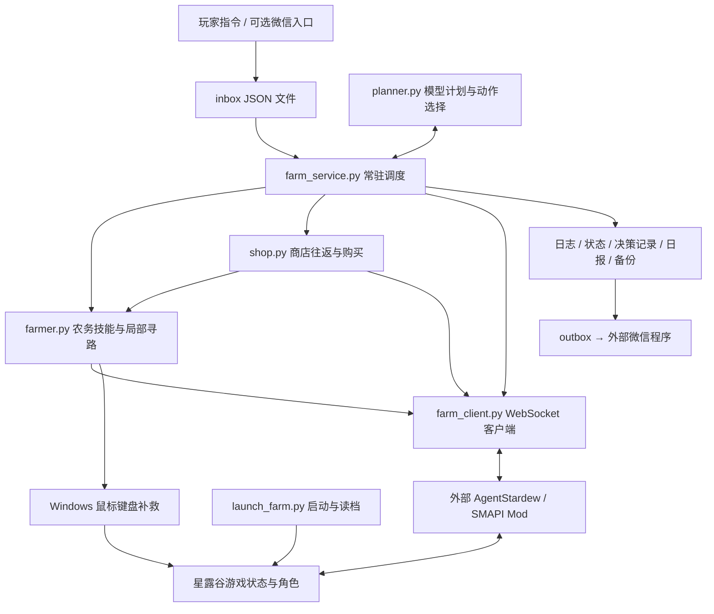

# 星露谷农场机器人：基础逻辑与创新方向

分析日期：2026-10-26  
仓库：[nauhcoaix/stardew-farm-bot](https://github.com/nauhcoaix/stardew-farm-bot)  
分析提交：`e6a6eec1dc7075839df3e168965afd9c2e507995`，分支 `main`。拉取后核对，本地 HEAD 与远端 main 一致。  
本地位置：`C:\Users\34861\Desktop\ideas\stardew_valley_dfy`

本文依据已拉取的 Python、PowerShell、批处理源码及仓库内说明编写。以下“现有实现”指静态代码可确认的行为；“建议”指尚未实现的设计。没有启动游戏、调用模型、安装 Mod 或发送微信消息，因此不把代码存在等同于实机验证通过。

## 1. 先看结论

这个项目的核心是一个**由游戏 Mod 提供感知与动作接口、由 Python 编排农活、由语言模型补充决策的自动化系统**。

它的主要工作方式是：

> 读取结构化游戏快照 → 判断当前状态 → 运行固定农活或模型选择的技能 → 调用游戏接口 → 读取新状态 → 进入下一轮。

三个认识最重要：

1. **感知主要来自 Mod。** 角色位置、体力、背包、地块、菜单都以 JSON 数据提供；主循环没有截图识别模型。Windows 鼠标键盘操作用于启动、读档、关菜单及过场补救。
2. **模型控制的是有限技能和参数。** 主循环会先执行固定农务，再询问模型下一步。模型既没有逐帧操控角色，也没有训练出的游戏策略网络。
3. **真正进入游戏内部的实现位于外部 Mod。** 本仓库含客户端、编排和部分寻路逻辑，不含 AgentStardew 的 C# 源码。因此能确认 Python 发出了什么命令，不能仅凭本仓库证明 Mod 如何调游戏方法、如何校验动作或执行底层移动。

我的创新判断：最值得发展的方向是**有长期目标与生活偏好的农场伙伴**。先让它能解释并验证“为什么今天这样安排”，再扩展钓鱼、矿洞、社交等技能，会比单纯增加动作数量更有价值。

## 2. 架构与代码入口



| 层 | 文件与关键入口 | 实际职责 |
|---|---|---|
| 启动 | `bot/start-farm.bat`；`launch_farm.py:133,192` | 找游戏窗口或启动 SMAPI，按比例点击加载与首个存档，再启动 `farm_service.py --loop` |
| 调度 | `farm_service.py:590,940` | 读取指令、更新每日计划、安排农务、处理节日与睡觉、写报告 |
| 模型 | `planner.py:73,127,212` | 生成每日参数、单个动作、自然语言任务的动作序列 |
| 技能 | `farmer.py:356` | 浇水、补水、收获、播种、清障、砍树、回屋与睡觉 |
| 寻路 | `farmer.py:797,806,844,872` | 可通行网格、四邻域 BFS、分段移动、清障开路 |
| 商店 | `shop.py:126` | 按地图路点往返商店，读取菜单并购买种子 |
| 协议 | `farm_client.py:29,47` | 握手、请求关联、等待响应、错误处理、动作封装 |
| 外部通信 | `farm_funcs.ps1`；`farm_service.py:129,141` | 文件收发箱；微信收发依赖另一套程序 |
| 备用探索 | `junimo.py`；`planner.py:275` | Junimo MCP 客户端与工具选择提示词，未接入当前主服务调用链 |

后文的行号均对应本文开头的固定提交。源码索引见末尾。

## 3. 它如何“看见”游戏

`Bridge.snapshot(radius)` 发送 `snapshot` 命令。农务代码期待的关键字段如下，具体值由 Mod 返回：

```text
snapshot
├── date / time / location
├── player
│   ├── position: x, y
│   ├── energy / maxEnergy
│   └── money / canMove / maxItems 等
├── inventory[]
│   └── slot / name / count / tool / water 等
├── entities[]
│   └── ref / kind / tile / crop / tilled / watered / passable 等
└── menu
    └── type / options[] / ref
```

`farmer.py` 用字段筛选目标：

- `water_targets()`：未浇水的土壤，具有作物或已经翻耕就算目标，**包含无作物的已耕地**。
- `empty_tilled()`：已经翻耕、没有作物且位于指定种植区的地块。
- `seeds_in()`：通过物品名称里的“种子”或 `Seeds` 判断种子。
- `tool_slot()`：先匹配工具类型，再用中文名称补充匹配。
- `harvest()`：遍历作物；缺少 `harvestable` 字段时默认尝试交互，成功响应计入收获次数。因此计数未必等于实际获得的作物数量。

`ref` 是桥提供的目标引用，例如客户端帮助中出现的 `@s3:e12`。控制代码用它告诉 Mod 操作哪个对象。睡眠代码还明确提醒：菜单引用绑定生成它的快照，必须使用对应快照中的引用。不能把它当作永久物品 ID。

**一个重要的接口边界：** `farm_client.summarize()` 读取的是 `observation.entities/tiles`，而农务层主要读取顶层 `entities`。仓库中没有统一归一化层，也没有实际桥响应样本证明两种结构兼容。落地时必须先核对 Mod 的真实快照格式。这里描述的是客户端期待的数据契约。

感知半径通常为 8～16 格，代码未维护完整、持久的世界地图。因此“附近没有目标”不意味着整个农场都没有目标。

## 4. 它如何“动手”

### 4.1 Python → 游戏桥

主链路连接 `ws://127.0.0.1:17654/`。`Bridge.request()` 发出的格式是：

```json
{
  "protocolVersion": 1,
  "requestId": "r...",
  "command": "use",
  "args": {"target": "@s3:e12"},
  "timeoutMs": 15000,
  "actionId": "a..."
}
```

处理过程：先确保 `hello` 成功，生成请求 ID，发送 JSON，等待相同 `requestId` 的响应；状态为 `completed` 时返回 `result`，否则抛出 `BridgeError`。默认截止时间是请求超时加 5 秒。

这里应称为**自定义 JSON 命令协议 over WebSocket**。虽然 README 将桥描述为“WebSocket + JSON-RPC”，这个客户端发送的并不是带 `jsonrpc/method/params` 字段的标准 JSON-RPC 2.0 报文。

`move/select/use/interact/menu` 五种基础写命令附带 `actionId`。其他通过 `request()` 直接发送的扩展命令不在这份集合中；不能由此推断它们具有相同的去重或幂等保证。

### 4.2 一次浇水的实际调用链

```text
farm_service.run_once()
  → Farmer.water_crops(snapshot)
    → water_targets(snapshot)
    → 水壶为空时 refill_if_needed(force=True)
    → Bridge.move(near=地块ref)
    → Bridge.select(水壶背包槽位)
    → Bridge.use(地块ref)
    → 使用返回的 snapshot 更新状态
    → 处理下一个地块
```

模型无需决定水壶槽位、目标坐标或每次按键。农务代码负责拆解，Mod 负责在游戏内落实。

补水会查找 `refillable` 对象；看不到水源时，先尝试记住的水源坐标，再探索预设点。成功发现水源后保存到 `farm-state.json`。

### 4.3 寻路并不是单一算法

代码同时使用三种方式：

1. **委托 Mod 移动**：多数地块动作直接调用 `move(near=ref)`。
2. **Python 局部 BFS**：`_passable_grid()` 从快照实体构造网格；`_bfs_path()` 按上下左右搜索可通行格。目标不可达时选已访问格中离目标曼哈顿距离最近的格。
3. **固定路点跨图**：`shop.py` 用预设坐标连接农场、森林、城镇、种子店。

`walk_to()` 默认沿路径取最多约 6 步后的格子作为下一段终点，移动后重新观察。农场内没有可走路径时尝试 `clear_toward()` 清障；该函数实际使用 BFS 返回路径上的格子判断邻接障碍，不是完整的可达区域集合。

这是“局部搜索 + 短距离执行 + 再观察”的导航。它尚未具备全局地图学习、动态出口图或按体力与时间综合定价的路线规划。

### 4.4 特殊接口与桌面补救

代码还请求 `menudump`、`menuclick`、`menuclose`、`shopbuy`、`chestget`、`chestput`、`placechest`、`ship`、`warp` 等扩展命令。是否全部受所安装 Mod 支持，需要单独确认。

其中 `warp` 已用于异常地图和节日回程补救；因此现有执行策略允许传送。备用工具提示词中的“不瞬移”不能代表当前主链路行为。

对于不认识的菜单、结算画面或角色无法移动，代码会聚焦游戏、尝试比例坐标点击和 Escape。`input.lock` / `wechat.lock` 用于协调游戏和外部微信程序对鼠标键盘的占用。这部分是桌面自动化，仍然受窗口与焦点影响。

## 5. 大模型到底决定什么

### 5.1 三个已接入的决策入口

| 入口 | 输入 | 输出 | 调用位置 |
|---|---|---|---|
| `planner.ask()` | 日期、体力、金钱、种子、背包、木材等摘要 | 每日计划 JSON | 日期的 `day` 值变化时，经 `refresh_plan()` 调用 |
| `planner.next_action()` | 当前状态摘要 | 一个 `action + arg + reason` | 白天固定农活后，经 `decide_next()` 调用 |
| `planner.plan_task()` | 玩家自然语言任务与状态摘要 | `steps[] + reply` | inbox 收到 `cmd=task` 时调用，执行最多 6 步 |

配置来源是 `FARM_CFG` 或 `bot/planner-config.json`。HTTP 请求使用 Chat Completions 风格，默认服务是 DeepSeek，要求 JSON 输出。缺少密钥或请求失败时通常返回 `None`；主服务有规则降级路径。

这是推理时的动作选择，仓库没有强化学习训练、奖励更新或持续训练逻辑。每次请求主要携带 system 提示词和当前状态；已有决策日志未作为长期记忆送回这些规划入口。

### 5.2 每日计划有一部分只是“表达”，尚未兑现为控制

`ask()` 要求输出作物、购种量、补货阈值、清障上限、清障体力阈值、是否砍树、睡眠时间与理由。

已读入主流程的字段包括 `buy_qty`、`buy_when_below`、`clear_limit`、`clear_min_energy`、`chop`、`sleep_at`。

但 **`crop` 未传入购买或播种执行器**：

- `shop.buy_seeds()` 按当前快照余额选择：至少 200G 时选土豆，否则选防风草；这里是代码分支，并非本文对游戏收益的推荐。
- `_buy()` 再按商店价格和可用金钱限制购买数量。
- `Farmer.plant()` 使用背包识别出的第一组种子。

所以即使模型计划“今天种花椰菜”，现有主链路也未保证实现这个选择。另外，多个数值读取写成 `value or default`，例如 `buy_qty=0` 会被替换为默认 20；规划输出与执行含义尚未完全一致。

### 5.3 真正的主循环顺序

按 `farm_service.run_once()` 白天分支提炼：

```text
读取 STOP / launch 指令
→ 连接桥并取快照
→ 处理 inbox：状态、浇水、睡觉、任务、决策查询、备份等
→ 必要时请求每日计划
→ 达到计划睡眠时间或收到睡觉命令：尝试睡觉、跨天备份和报告
→ 否则进入白天分支：
    整理背包 / 回农场 / 必要时补种子
    关菜单 → 出门 → 收获 → 清障 → 按计划可选砍树
    首次尝试取开局包裹 / 找种子
    有种子就翻地播种 → 浇水
    检查低体力与节日
    参加节日，或询问模型下一动作
    执行模型动作；没有动作则再跑规则农务
    尝试放箱子 → 存货与发货 → 更新统计
→ 关闭本轮桥连接
→ --loop 下分 6 次各等 5 秒，再开启下一轮
```

这意味着：

- 实际节奏是“一轮工作耗时 + 约 30 秒等待”，不是严格每 30 秒做一次决策；定义的 `WORK_INTERVAL_MIN=25` 没有用于调度。
- 即使模型准备选择休息或卖货，之前那轮固定农活也可能已经消耗体力。
- 每轮模型动作不一定只操作一个格子，`water`、`harvest` 等是批量技能。
- 模型无响应时可能在已有固定农活之后再执行 `rule_work()`。
- “浇水优先”写在提示词中，但实际固定顺序里清障和翻种发生在浇水之前。提示词偏好没有完全变成调度约束。

## 6. 经济、时间和记忆的实际范围

### 6.1 农场经营

种植区硬编码为 `x=60..69, y=15..22`，翻地与空地播种受此区域限制。水源候选点、农舍默认坐标、箱子位置和商店路线也具有标准农场布局假设。

`stash_items()` 保留工具、种子、木材与硬木；指定杂物放箱子；其余非保留物品尝试发货。这里没有社区中心、赠礼、制作材料或任务预留清单。

现有购买逻辑没有形成“季节剩余天数 → 成熟时间 → 现金回流 → 明日维护成本”的经营模型。不能把模型自然语言里的种植建议直接理解为已执行的经济优化。

### 6.2 时间与节日

睡眠通过找门、进屋、找床或 Sleep 动作、确认菜单、等待新日期完成。部分跨天分支会备份存档并排队日报。

节日由硬编码日期表驱动，尝试进场、找镇长、购买指定种子与离场；有超时及传送补救。本文不把表中所有时间、入口和购买流程视为已核实的游戏规则。

不同路径的商店时间限制也不相同：提示词、`shop.py` 常量、主服务对模型购买动作的 16:00 限制分别存在。扩展经营策略前应把营业时间和日历变成统一的数据来源。

### 6.3 持久化与通信

| 数据 | 用途 | 当前边界 |
|---|---|---|
| `farm-state.json` | 记住水源与农舍门坐标 | 属于少量空间记忆 |
| `decisions.jsonl` | 动作、参数、理由、时间与体力 | 主要记录模型决策，不覆盖全部固定操作，也未形成统一前后状态验证 |
| `status.json` | 对外展示当前状态 | 在主循环中的写入位置有限，不是全程持续刷新的完整状态流 |
| `reports/day-*.txt` / outbox | 日报与待发送消息 | 某些键和文件名只使用日号，跨季跨年不能自然区分 |
| `backups/` | 将存档目录打包，默认保留最近 7 个备份 | 备份已存在，但没有自动分支实验与策略比较系统 |
| 进程内全局变量 | 当日计划、买种与节日标记等 | 并非完整的重启恢复状态 |

`farm_funcs.ps1` 提供微信接入函数，但依赖外部程序的配置、窗口、发送函数等环境；`start-wechat.bat` 也指向外部 `wechat-auto`。主服务写入 outbox 不代表消息已经成功发送。

## 7. 当前能力边界：为创新确定起点

| 可以从代码确认 | 还不能由当前仓库证明或直接提供 |
|---|---|
| 有农务技能、局部 BFS、文件指令、模型计划和降级规则 | 任意地图与任意农场布局的可靠自治 |
| 有 AgentStardew WebSocket 客户端 | Mod 内部动作实现与所有扩展命令兼容性 |
| 有启动阶段的 `localhost:7842/status` 探测兜底 | 主服务已完整兼容 NagiBridge HTTP 后端 |
| 有 `junimo.py` 的 MCP stdio 客户端 | 主服务通过 Junimo 运行；仓库也未提供其 exe |
| 有 `planner.next_tool()` 工具选择接口 | 该接口参与了当前 `run_once()` 主循环 |
| 有同类项目的 `docs/` 调研资料 | 那些项目的矿洞、钓鱼、多人伙伴等能力已被集成 |
| 有决策理由和日报 | 自主学习、长期记忆、可核验的每一步因果解释 |

运行路径还有一个容易误解的点：`launch_farm.py` 将 `FARM_DATA` 或代码目录作为 DEV，再把其父目录当游戏目录寻找 `StardewModdingAPI.exe`。所以把仓库放到桌面并不会自动定位已安装游戏；未来启动前需配置符合这一推导的路径或调整路径设计。

## 8. 创新建议：让它成为会经营、会协作的伙伴

下面是设计提案，不代表已实现，也不承诺特定收益倍数。

### 8.1 首选：长期目标驱动的农场伙伴

让玩家描述愿望，例如：

> “这个春天留一片花园；日常浇水你负责；给我留足下矿的体力；收成先保留任务需要的物品。”

系统将其保存为结构化目标：目标期限、保留物品、可用资金、体力预算、禁止改动区域、玩家负责事项。人格偏好改变目标权重，例如重视利润、景观、探索或社交，而不只是改变说话语气。

建议的职责划分：

```text
玩家长期目标与偏好
      ↓
战略计划：未来若干天做什么、为什么
      ↓
候选动作生成与约束检查：当前确实能做哪些事
      ↓
日内调度：优先级、路径、体力与时间预算
      ↓
现有 Farmer / shop 技能
      ↓
结果验证与记忆更新
```

保留现有技能的价值，把 `run_once()` 内的固定流水线逐步转成同一个调度器可选择的任务，避免固定逻辑与模型各自安排一遍。

**最小版本：** 保存一个长期目标，确保购买和播种确实执行选定种类，并在日报说明目标进度、保留资源及未完成原因。

**验收：** 给相同快照分别配置“保留任务材料”和“尽快回笼资金”，库存处理应产生可解释差异；目标跨服务重启仍然存在。

### 8.2 让模型在“可行的方案”里选

每个技能补上可供调度器查询的描述：

```text
技能：WaterPlot
前置条件：指定地图与区域已观察，存在待浇地块，可找到水壶和水源
成本估计：行走时间、工具消耗、补水次数、模型请求成本
完成条件：目标作物的待浇集合减少或清零
中断条件：玩家接管、时间预算不足、剩余体力达到保留值
结果：成功 / 部分完成 / 受阻，并带前后状态证据
```

让代码根据当前状态生成候选动作，模型负责在可行候选里取舍。模型输出 `reason` 是选择理由；“已浇完”则应由状态差分证明。

**最小版本：** 先只覆盖浇水、播种、购买三个技能，贯通资源预算和完成条件。

**验收：** 水壶为空时能先安排补水；购买失败不能报成购买成功；`buy_qty=0` 的目标确实不购买；播种区域无可用格时报告受阻而非重复尝试。

### 8.3 农场经营沙盘：先比较，再行动

建立轻量作物与资源模型，比较几种未来若干天的方案：

- 留着现金还是继续扩种；
- 种植面积与后续每日浇水负担；
- 现在清路是否能减少未来往返；
- 哪些物品要留给任务、制作或玩家。

一种可解释的候选评分可以是：

```text
方案得分 = 目标进展 + 预计现金收益 + 玩家偏好满足度
         - 时间成本 - 体力成本 - 失败风险 - 推理成本
```

各项先归一化或分别展示，再使用玩家可调权重，避免把金币、分钟、体力直接随意相加。先做规则模拟，不必一开始训练复杂世界模型；游戏数据和版本差异通过桥或经核实的数据表进入系统。

**最小版本：** 对当前可购买的两种种子做短期现金流与体力预算比较，并输出一张方案对照表。

**验收：** 记录预测与实际偏差；用同一起始存档比较固定规则、当前模型和新规划器，报告完整结果，不能用一局表现得出普遍结论。

### 8.4 让地图变成会积累的资产

把单次快照变成按地图保存的空间记忆：水源、出口、地块、箱子、保护区、未知区，以及最近观察时间。地块使用“地图 + 坐标”定位；操作时再取得最新 `ref`。

在此基础上，将“清障”从无差别劳动变成投资决策：优先打通高频路线、连接水源、形成连续种植区。农场美学也可以成为显式目标，例如给玩家保留林区、池塘边观景区和道路。

**最小版本：** 自动发现农舍门与水源，保存一条可复用通路，允许玩家指定一个保护区域。

**验收：** 保护区域不被清理；阻塞后能重新观察并换路；地图变化后旧记忆被标记过期，而不是持续撞向旧坐标。

### 8.5 从遥控指令升级为玩家分工

支持任务所有权和交接：玩家下矿时伙伴负责农务；玩家接近或手动接管时，机器人在动作边界暂停；恢复时先刷新状态，不继续使用旧目标。

分两步落地：

1. 先在现有单角色模式实现“暂停—交接—恢复”，明确当前控制权。
2. 再评估外部 Mod 是否支持第二角色或 farmhand，实现真正同时协作；当前仓库不能直接提供这一点。

**验收：** 交接后没有继续发出的游戏写命令；恢复时会检查玩家是否已完成任务；对“帮我照料这片地”的约定能保持到取消或完成。

### 8.6 经营日志变成可回放的成长记忆

将现有日志扩展为事件链：完整日期、运行 ID、任务 ID、动作前状态摘要、预计结果、实际结果、错误类型、下一决策。

系统可以从记录估计“这条路线通常多久”“这项技能经常卡在哪里”“今天为什么比昨天慢”。这些是可测量的经验参数；模型读取相关片段生成解释，不必把全部日志塞进上下文。

**最小版本：** 为每次浇水任务记录目标数量与实际减少数量，为购买记录钱和种子数量差分。

**验收：** 日报中的成功数能够回溯到事件证据；用户问“为什么今天没扩种”时，回答能指向体力、资金或保留区等实际约束。

## 9. 推荐实施顺序

| 阶段 | 实际交付 | 完成标准 |
|---|---|---|
| 0：建立可验证底座 | Mod 能力探测、统一快照格式、动作结果结构 | 用真实桥样本确认字段与命令；失败/无变化不计作成功 |
| 1：打通一个长期目标 | 目标存储、作物选择贯穿购买与播种、三个技能的约束 | 玩家说要种什么，实际购买与种下什么一致；无法完成时说明原因 |
| 2：形成日内经营计划 | 统一调度、预算、地图记忆、短期方案比较 | 相同起点的对照实验可以复现；不靠反复重做固定农活维持循环 |
| 3：形成伙伴体验 | 玩家接管、保护区、偏好、可追溯日报 | 连续多个游戏日保持约定；玩家干预后能合理恢复 |
| 4：扩展生活技能 | 根据桥能力加入矿洞、钓鱼、社交或第二角色 | 每种新技能均具备前置条件、预算、结果验证与退出路径 |

我建议第一个原型只实现一个故事：**玩家指定一片地和一种作物，机器人安排购买、种植、浇水，并在下一天解释实际进展。** 这个原型同时验证目标理解、规划兑现、空间约束、跨日记忆与结果报告，足以判断新架构是否有价值。

评价它时同时记录：目标完成率、玩家接管次数、无效动作比例、实际收支与库存、体力和时间消耗、模型请求次数与成本。将自动传送标为单独事件，区分“正常路径完成”与“补救后完成”。同一起始状态重复比较，才能判断改进来自规划而非偶然。

## 10. 源码索引与分析边界

以下链接固定到本次提交，便于按原代码核对：

- [主循环与固定农务顺序：farm_service.py 第 590 行起](https://github.com/nauhcoaix/stardew-farm-bot/blob/e6a6eec1dc7075839df3e168965afd9c2e507995/bot/farm_service.py#L590)
- [模型动作选择与分发：farm_service.py 第 427 行起](https://github.com/nauhcoaix/stardew-farm-bot/blob/e6a6eec1dc7075839df3e168965afd9c2e507995/bot/farm_service.py#L427)
- [模型接口与每日计划：planner.py](https://github.com/nauhcoaix/stardew-farm-bot/blob/e6a6eec1dc7075839df3e168965afd9c2e507995/bot/planner.py#L73)
- [WebSocket 协议：farm_client.py](https://github.com/nauhcoaix/stardew-farm-bot/blob/e6a6eec1dc7075839df3e168965afd9c2e507995/bot/farm_client.py#L47)
- [浇水、收获、种植：farmer.py 第 593 行起](https://github.com/nauhcoaix/stardew-farm-bot/blob/e6a6eec1dc7075839df3e168965afd9c2e507995/bot/farmer.py#L593)
- [BFS 与分段寻路：farmer.py 第 797 行起](https://github.com/nauhcoaix/stardew-farm-bot/blob/e6a6eec1dc7075839df3e168965afd9c2e507995/bot/farmer.py#L797)
- [购买选择与路线：shop.py 第 126 行起](https://github.com/nauhcoaix/stardew-farm-bot/blob/e6a6eec1dc7075839df3e168965afd9c2e507995/bot/shop.py#L126)
- [启动和桥探测：launch_farm.py](https://github.com/nauhcoaix/stardew-farm-bot/blob/e6a6eec1dc7075839df3e168965afd9c2e507995/bot/launch_farm.py#L133)
- [独立 Junimo MCP 客户端：junimo.py](https://github.com/nauhcoaix/stardew-farm-bot/blob/e6a6eec1dc7075839df3e168965afd9c2e507995/bot/junimo.py)

本文将仓库内 `docs/` 视为研究背景，不把其中其他项目的功能和说明当作本仓库运行事实。未验证外部 Mod 内部实现、游戏实机行为或经营收益；这些应在下一步可运行原型中逐项用状态证据验证。本次只新增分析文档，没有修改机器人源码。
