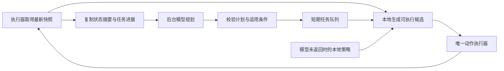

# 持续行动方案：让模型思考与游戏执行并行

分析日期：2026-10-26  
代码位置：`C:\Users\34861\Desktop\ideas\stardew_valley_dfy`  
当前提交：`f33ea486455e54eb0b1a3c023f107cf7a2b84ec9`，已核对远端 main 一致。  
本地 `bot/planner.py` 与 `.gitignore` 另有未提交修改；本分析读取当前工作区，没有改动这些文件。

## 1. 这次真正要解决什么

玩家希望角色在模型思考期间继续完成有价值的工作。问题重点是决策与行动的节奏，不是把所有停顿都当作游戏卡死。

目标应该定义为：**存在可执行任务时，不因等待模型而停止派发动作；缺少资源或需要休息时，执行明确的恢复或收工策略。**

单纯让角色持续移动，或者反复清障消耗体力，并不算完成这个目标。

## 2. 新代码中，等待发生在哪里

| 位置 | 当前行为 | 对行动节奏的影响 |
|---|---|---|
| `farm_service.py:323` | `return await asyncio.to_thread(planner.ask, text)` | 请求每日计划时，上层执行流程等结果 |
| `farm_service.py:771` | `PLAN = await refresh_plan(...)` | 新一天先等模型，再继续日间流程 |
| `farm_service.py:514` | `return await asyncio.to_thread(planner.next_action, text)` | 模型思考期间，没有在这个调用链继续执行农务 |
| `farm_service.py:911` | `act = await decide_next(...)` | 做完固定农活后，再等待下一动作 |
| `farm_service.py:941–943` | 模型返回空结果之后才调用 `rule_work()` | 规则备用动作填不上正在等待模型的时间 |
| `farm_service.py:1037–1040` | 每轮结束执行六次 `sleep(5)` | 无论是否还有活，都额外留出约 30 秒空档 |
| `planner.py:161` | 单次动作接口默认网络超时参数为 45 秒 | 缓慢请求仍处在执行流程的必经路径上 |

关键区别：`to_thread()` 使 HTTP 请求不占住 asyncio 事件循环，但调用者接着 `await` 它，游戏执行流程仍然等待。即时回执循环可以工作，不等于人物能继续工作。

当前决策节奏接近：

```text
固定农活 → 等模型 → 执行模型动作 → 整理 → 等约30秒 → 下一轮
```

已有日志中，部分每日计划请求约 3～4 秒后返回；这是少量样本，不代表全部模型请求的延迟。现有日志没有为每次动作决策同时记录请求开始和结束，因此不能把两条“模型决定”日志的间隔直接当作推理时间。

此外，当前已经完成固定农务后，又让模型决定同一组农务动作，容易出现“刚浇完又想浇水”“体力已经不满足清障阈值仍选择清障”等无效决策。模型的调用频率与行动价值没有形成对应关系。

## 3. 推荐结构：后台规划，前台持续执行



只让一个执行器向游戏发送动作。后台规划器只接收状态副本、调用模型、返回计划，不访问同一个 Bridge，不直接操作角色。

这样可以同时满足两件事：模型持续思考下一阶段，人物持续执行当前有效任务。游戏 Mod 的唯一写动作约束、WebSocket 响应匹配以及目标引用都能保持顺序。

### 3.1 本地执行器负责及时反应

执行器根据当前状态完成确定性判断，无需每次请模型批准。例如：

- 当前任务是浇水且水壶为空：先补水，再回到任务。
- 当前允许照料作物且附近有待浇作物：继续浇。
- 玩家已指定种植种类与区域，且还有种子和空地：继续种。
- 当前任务已完成：取下一项有效任务。
- 剩余体力触及保留值：停止扩张或清障，按约定安排恢复、回家或睡觉。
- 任务暂时不可做：标记原因并换一项，避免反复执行同一个空操作。

本地策略也要遵守玩家目标、物品保留和保护区域。例如，没有获准清理树林时，不应为了保持忙碌而自行砍树。

### 3.2 模型负责需要取舍的决策

保留模型价值高的工作：选择作物、决定扩种与留钱的比例、安排节日和采购、理解玩家新任务、在多种可行方案之间取舍。

模型输出从“立刻做一个动作”升级为“一个短期计划或策略”，例如：

```json
{
  "goal": "照料现有作物后完成指定区域播种",
  "steps": [
    {"action": "water", "scope": "assigned_plot", "until": "no_dry_crops"},
    {"action": "till_plant", "scope": "assigned_plot", "max_tiles": 6},
    {"action": "water", "scope": "assigned_plot", "until": "no_dry_crops"}
  ],
  "constraints": {"reserve_energy": 50, "allow_buy": false},
  "reason": "先履行当前照料任务，再使用剩余预算播种"
}
```

这是建议新增的契约，现有 `run_action()` 尚不接受这些字段。第一阶段可复用 `plan_task()` 已有的最多六步思路，但应新增自主短期规划入口，不把用户任务翻译提示词直接当通用规划器。

计划应表达区域和完成条件；不要存储长时间后再执行的 `@s...` 引用。执行前用最新快照定位对象，并重新检查体力、时间、库存和目标是否已完成。

### 3.3 提前补计划，而不是用完才问

当剩余任务的预计执行时长快要不足以覆盖模型响应时间时，就提前请求下一段计划。

```text
触发补计划：剩余可执行时长 < 模型响应耗时的P95 + 余量
```

初期没有统计数据时，可以先在剩余一项任务时请求，之后再按测得的耗时调整。队列长度和任务数量不等于可执行时长，一项采购和一项浇水的耗时可能差别很大。

同时最多保留一个在途模型请求；状态每更新一次不等于要再发一次请求。将变化合并，避免请求堆积与旧方案晚到覆盖新方案。

### 3.4 等待模型时也有明确工作来源

优先顺序建议是：

1. 处理玩家停止、接管等控制要求。
2. 处理时间、体力、菜单等必要状态。
3. 继续当前仍然有效的任务。
4. 从已验证的短期队列取下一项。
5. 执行玩家目标范围内的本地备用任务。
6. 没有可执行任务时，记录具体原因并等待事件或按约定收工。

模型超时或暂时不可用时，执行器保持这个流程。后台规划使用退避重试；不在人物行动链里反复等待网络。

## 4. 任务要能在小段之间切换

当前 `water_crops()`、`plant()`、`harvest()` 往往处理整批目标。直接在外层加后台规划后，新计划仍可能要等整批技能结束才能生效。

建议把长技能改成可续跑的小段，例如每次处理少量地块，然后返回：

```text
任务ID、状态、完成数量、剩余目标、受阻原因、最新快照
```

初始可以每段处理 1～3 个目标，依据实测调整。时间预算在原子动作之间检查；不要为了严格卡住几秒钟，随意取消已经开始的工具动作或购买操作。

任务完成后重新检查，下一段可以换任务，也可以继续当前任务。新模型计划在这些边界合并，避免一边浇水一边突然切换为跨地图购买。

后台模型拿到的是过去的状态，因此其返回结果必须重新验证。例如它建议再浇五格，但执行器已经浇完，就跳过这一步；不为执行过时计划而重复行动。

## 5. 代码如何分阶段调整

### 第一步：先消除明确的人工空档

- 将 `main()` 的固定约 30 秒等待改为按状态调度：有待执行任务就继续；无任务、断线或等待外部事件时才等待。
- 用事件或短间隔控制检查保持 STOP 响应，避免无等待的空转循环。
- 为模型调用记录开始时间、结束时间、结果是否被采用；分别记录游戏执行耗时。

这一阶段能直接改善节奏，但仍然存在逐步等待模型的问题。

### 第二步：拆开规划与执行生命周期

- 由服务持有规划状态、在途请求、计划版本和任务队列，跨 `run_once()` 保留。
- 由唯一执行器生成不可变状态摘要，再调用 `asyncio.create_task(asyncio.to_thread(...))` 发起模型请求。
- 检查请求是否完成；完成才取结果，没有完成就继续已有任务或规则任务。
- 不把 `decide_next(b, f, snap)` 原封不动丢进后台：它目前先调用 `b.request("menudump")`，会与执行器争用同一连接。
- 不在带旧 Bridge 的任务仍运行时关闭该连接；更清晰的方式是执行器持有稳定连接，规划器完全不持有连接。

核心伪代码如下，展示的是职责而非可直接替换的完整实现：

```python
while running:
    snap = await executor.observe()
    handle_control_requests()

    if planner.has_result():
        queue.merge(validate_against_current_state(planner.result(), snap))

    if queue.needs_refill() and not planner.in_flight():
        planner.start(copy_state_summary(snap), queue.remaining_work())

    task = choose_valid_task(snap, queue, player_constraints)
    if task is not None:
        await executor.run_one_chunk(task)
    else:
        await wait_for_state_change_or_retry()
```

若继续用 `to_thread()` 包住 urllib，还需注意：取消 asyncio 包装任务不会立即终止底层 HTTP 线程。不要超时后不断创建新线程；限制在途请求数，使用有明确网络截止时间的实现，并在停机时管理其生命周期。

### 第三步：减少低价值推理

- 固定农务流程和模型任务统一进入同一个调度器，去掉两套重复安排。
- 当天目标没有变化、任务执行顺利时，不重复问“下一步做什么”。
- 新玩家任务、计划用尽、任务受阻、资源明显变化、关键日程临近时才触发规划。
- 允许模型复用当前计划，不要求每次给出新动作。

模型选择更快、缩短理由和减少输出可以作为后续调优；先将模型移出执行必经路径，才能避免网络波动直接变成人物停顿。

## 6. 如何知道改进是否有效

需要把“等待模型”与“游戏动画、正常走路、休息、等待开门”等状态分开计时。

| 指标 | 用途 |
|---|---|
| 因模型等待导致的空闲秒数 | 直接衡量本次问题 |
| 有可执行任务时的派发间隔 | 判断任务交接是否连续，不计游戏内正常动作耗时 |
| 每游戏日模型请求次数 | 判断是否把确定性工作反复交给模型 |
| 计划被丢弃或重排的比例 | 判断提前规划是否过早、状态是否过时 |
| 每分钟有效完成数量 | 区分有价值工作与无效忙碌 |
| 体力消耗、任务完成率、玩家接管次数 | 防止以乱清障或消耗资源换取表面连续 |

建议的离线验证场景：模拟模型分别延迟 1 秒、10 秒、30 秒，执行器仍应在现有任务和允许的备用任务之间连续工作；模型失败时也不停止本地执行。

再验证过时计划：模型思考时本地已浇完水，晚到的“浇水”计划应被跳过；玩家在此期间改目标，旧请求结果应失效；STOP 应在原子动作边界及时生效。

这些是下一阶段的验收设计，本文未声称新架构已经实现或实机通过。原有源码未作修改。

## 7. 优先结论

最先做的三件事是：**去掉有任务时固定的 30 秒空档；模型后台提前生成短期计划；执行器在模型等待期间继续有效任务与本地策略。**

把“模型回答”变为执行器可利用的一种输入，而不是每次继续行动都必须跨过的一道门槛。
